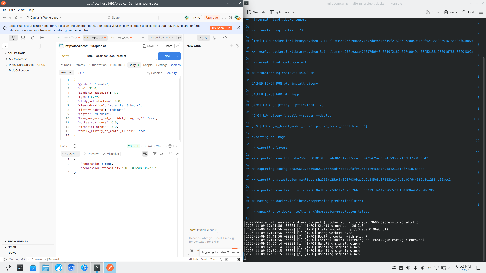

# Student Depression Prediction – ML Zoomcamp Mid-Term Project

## Project Overview

This project was developed as part of the Machine Learning Zoomcamp course mid-term project.

The main goal of this project is to predict whether a student is experiencing depression based on different features from a dataset containing approximately 20,000 records.

During the project, I performed data preparation, model training, hyperparameter tuning, and model evaluation.

I trained and tuned three different machine learning models:
- Logistic Regression
- Random Forest
- XGBoost

After comparing their performance using different machine learning evaluation metrics, XGBoost achieved slightly better results than the other models.

For this reason, I selected XGBoost as the final model and prepared it for deployment using Docker.

---

## Technologies Used

- Python
- Pandas
- NumPy
- Scikit-learn
- XGBoost
- Pipenv
- Docker

---

## Project Setup

### 1. Clone the Repository
First, clone the project repository using the following command:

```bash
git clone https://github.com/damsta02/ml_zoomcamp_midterm_project.git
```

### 2. Create a Virtual Environment
Navigate to the project directory:

```bash
cd ml_zoomcamp_midterm_project
```

Install the required dependencies and create a virtual environment using Pipenv:

```bash
pipenv install
```

After the installation is complete, activate the virtual environment:

```bash
pipenv shell
```

---

## Running the Project with Docker

The project also includes a Dockerfile, which allows you to build and run the application inside a Docker container.

### 1. Build the Docker Image
From the root directory of the project, run:

```bash
docker build -t depression-prediction .
```

This command builds a Docker image named `depression-prediction`.

### 2. Run the Docker Container
After successfully building the image, start the container using:

```bash
docker run -it -p 9696:9696 depression-prediction
```

The application will run inside the Docker container and expose port `9696`.

### 3. Testing the Model with Postman

Testing the model running inside the Docker container can be done using Postman by following these steps:

1. Create a **POST** request.
2. Enter the URL: `http://localhost:9696/predict`
3. In the **Body** tab, select `raw` and set the format to `JSON`.
4. Pass the following JSON payload:

```json
{
  "gender": "female",
  "age": 31.0,
  "academic_pressure": 4.0,
  "cgpa": 5.79,
  "study_satisfaction": 4.0,
  "sleep_duration": "more_than_8_hours",
  "dietary_habits": "moderate",
  "degree": "m.pharm",
  "have_you_ever_had_suicidal_thoughts_?": "yes",
  "work/study_hours": 6.0,
  "financial_stress": 5.0,
  "family_history_of_mental_illness": "no"
}
```



---

## Final Model

After training and tuning all three models, I compared their performance using machine learning evaluation metrics.

Although the results were relatively close, XGBoost achieved the best overall performance. Therefore, it was selected as the final model and used for the Docker deployment.

---

## Conclusion

This project demonstrates the complete machine learning workflow, starting with data preparation and model training, followed by hyperparameter tuning, model evaluation, and deployment using Docker.

The main objective was not only to build a predictive model but also to make it possible to run the selected model in a containerized environment.
